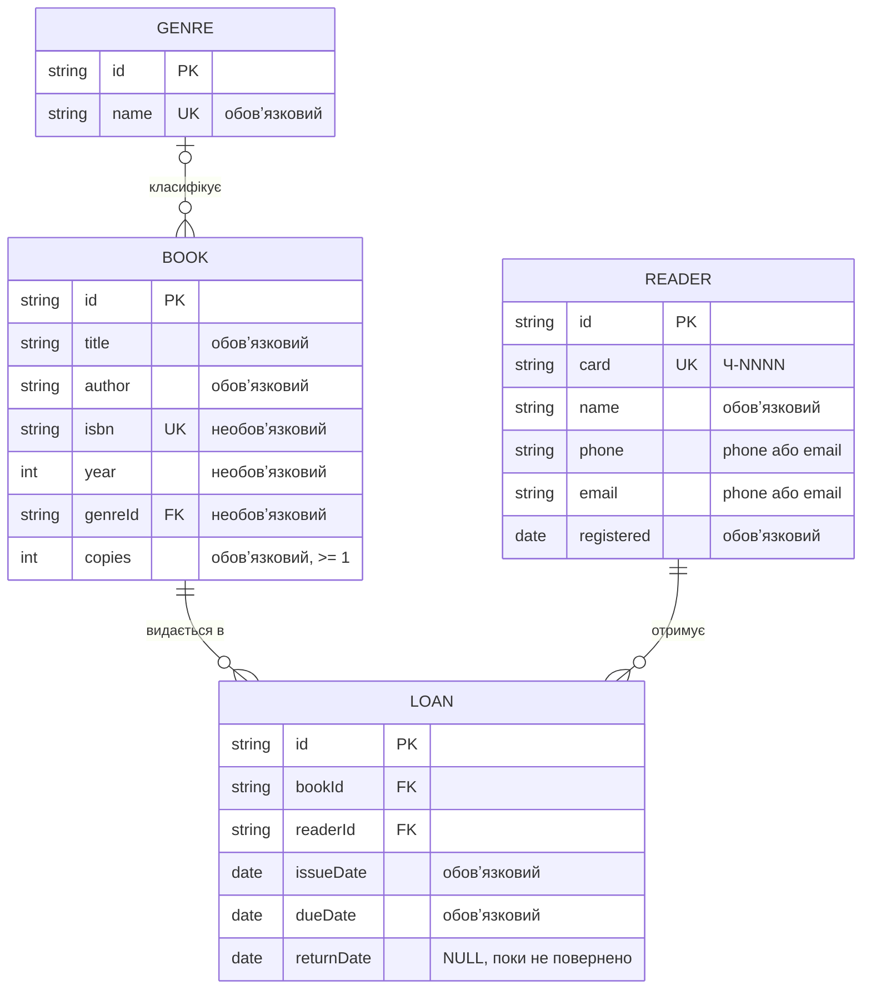

# ER-модель даних

Діаграма у форматі PlantUML: [er-model.puml](er-model.puml). Нижче наведено ту саму модель у форматі Mermaid (відображається на GitHub і в переглядачі Markdown у VS Code), опис сутностей, атрибутів і звʼязків.

## 1. Діаграма (Mermaid)



## 2. Сутності та атрибути

### GENRE — Жанр
Довідник жанрів, за якими класифікуються книги каталогу (роман, поезія тощо). Використовується для фільтрації каталогу.

| Атрибут | Тип | Обовʼязковий | Обмеження | Опис |
|---|---|---|---|---|
| `id` | string | так | PK, генерується системою | Ідентифікатор |
| `name` | string | так | UNIQUE, не порожній | Назва жанру |

### BOOK — Книга
Назва в каталозі бібліотеки. Одна книга може мати кілька однакових примірників.

| Атрибут | Тип | Обовʼязковий | Обмеження | Опис |
|---|---|---|---|---|
| `id` | string | так | PK, генерується системою | Ідентифікатор |
| `title` | string | так | не порожній | Назва |
| `author` | string | так | не порожній | Автор |
| `isbn` | string | ні | UNIQUE (якщо вказано); 10–17 символів: цифри, `-`, пробіл, `X` | Міжнародний стандартний номер книги |
| `year` | integer | ні | 1000 … поточний рік | Рік видання |
| `genreId` | string | ні | FK → GENRE.id | Жанр книги |
| `copies` | integer | так | ≥ 1 і ≥ кількості неповернених видач | Кількість примірників |
| `/available` | integer | — | похідний | Вільні примірники = `copies` − кількість видач цієї книги з `returnDate = NULL` |

### READER — Читач
| Атрибут | Тип | Обовʼязковий | Обмеження | Опис |
|---|---|---|---|---|
| `id` | string | так | PK, генерується системою | Ідентифікатор |
| `card` | string | так | UNIQUE; формат `Ч-NNNN`; присвоюється автоматично, не змінюється, не перевикористовується | Номер читацького квитка |
| `name` | string | так | щонайменше два слова | ПІБ |
| `phone` | string | умовно | 10–18 символів: цифри, пробіли, `( ) -`, необовʼязковий `+`; потрібен `phone` **або** `email` | Телефон |
| `email` | string | умовно | формат `імʼя@домен.зона` | Електронна пошта |
| `registered` | date | так | встановлюється системою | Дата реєстрації |
| `/activeLoans` | integer | — | похідний, ≤ 5 | Кількість неповернених видач |
| `/isDebtor` | boolean | — | похідний | Чи є хоча б одна прострочена видача |

### LOAN — Видача
Факт видачі однієї книги одному читачеві. Є асоціативною сутністю між BOOK і READER: один читач може мати багато видач, одна книга — багато видач (у різний час або різним читачам).

| Атрибут | Тип | Обовʼязковий | Обмеження | Опис |
|---|---|---|---|---|
| `id` | string | так | PK | Ідентифікатор |
| `bookId` | string | так | FK → BOOK.id | Видана книга |
| `readerId` | string | так | FK → READER.id | Читач |
| `issueDate` | date | так | ≤ сьогодні | Дата видачі |
| `dueDate` | date | так | `issueDate` + 1…90 днів; може змінюватися продовженням | Дата, до якої треба повернути |
| `returnDate` | date | ні | NULL, поки книга на руках | Фактична дата повернення |
| `/status` | enum | — | похідний: `active` / `overdue` / `returned` | Статус видачі |

## 3. Звʼязки

| Звʼязок | Кардинальність | Опис | Правило видалення |
|---|---|---|---|
| GENRE — BOOK | 0..1 : 0..N | До одного жанру може належати багато книг; книга має не більше одного жанру або не має його зовсім | Видалення жанру не видаляє книги: у них `genreId` стає NULL |
| BOOK — LOAN | 1 : 0..N | Книгу можна видати багато разів; кожна видача стосується рівно однієї книги | Видалення книги заборонене, поки є неповернені видачі; інакше видачі видаляються каскадно |
| READER — LOAN | 1 : 0..N | Читач може мати багато видач; кожна видача належить рівно одному читачеві | Видалення читача заборонене, поки є неповернені видачі; інакше видачі видаляються каскадно |

Обмеження, які охоплюють кілька записів (перевіряються під час видачі):
- для кожної книги кількість видач із `returnDate = NULL` ≤ `copies`;
- для кожного читача кількість видач із `returnDate = NULL` ≤ 5;
- не може існувати двох видач з однаковими (`bookId`, `readerId`) та `returnDate = NULL`;
- нова видача неможлива, якщо в читача є видача зі статусом `overdue`.

## 4. Похідні атрибути

| Атрибут | Формула |
|---|---|
| `BOOK.available` | `copies − COUNT(LOAN WHERE LOAN.bookId = BOOK.id AND returnDate IS NULL)` |
| `READER.activeLoans` | `COUNT(LOAN WHERE LOAN.readerId = READER.id AND returnDate IS NULL)` |
| `READER.isDebtor` | `EXISTS(LOAN WHERE LOAN.readerId = READER.id AND status = 'overdue')` |
| `LOAN.status` | `returned`, якщо `returnDate IS NOT NULL`; `overdue`, якщо `dueDate < сьогодні`; інакше `active` |

## 5. Фізичне зберігання

Дані зберігаються в `localStorage` браузера під ключем `library-system-v1` як один JSON-обʼєкт:

```json
{
  "books":   [{ "id": "b1", "title": "Кобзар", "author": "Тарас Шевченко", "isbn": "978-966-03-4512-7", "year": 1840, "genre": "Поезія", "copies": 4 }],
  "readers": [{ "id": "r1", "card": "Ч-0001", "name": "Олена Коваленко", "phone": "+380 67 123 45 67", "email": "olena.k@example.com", "registered": "2026-01-08" }],
  "loans":   [{ "id": "l1", "bookId": "b1", "readerId": "r1", "issueDate": "2026-11-14", "dueDate": "2026-11-28", "returnDate": null }],
  "nextCard": 6
}
```

- Дати зберігаються як рядки `YYYY-MM-DD`.
- `nextCard` — службовий лічильник для наступного номера квитка; він не зменшується після видалення читача, тому номери не повторюються.
- Необовʼязкові текстові поля зберігаються як порожній рядок, а незаповнений `year` — як порожній рядок замість числа.
- Похідні атрибути не зберігаються: вони обчислюються в `store/LibraryContext.jsx` (функція `deriveData`).
- Сутність GENRE у поточній версії зберігається спрощено: у книзі записано назву жанру (`genre`), а список жанрів для фільтра формується з наявних книг. Окрема таблиця жанрів зʼявляється в реляційній схемі нижче.

## 6. Відповідна реляційна схема (PostgreSQL, для майбутньої серверної версії)

```sql
CREATE TABLE genre (
  id    VARCHAR(32)  PRIMARY KEY,
  name  VARCHAR(100) NOT NULL UNIQUE
);

CREATE TABLE book (
  id        VARCHAR(32)  PRIMARY KEY,
  title     VARCHAR(255) NOT NULL,
  author    VARCHAR(255) NOT NULL,
  isbn      VARCHAR(17)  UNIQUE,
  year      SMALLINT     CHECK (year BETWEEN 1000 AND 2100),
  genre_id  VARCHAR(32)  REFERENCES genre(id) ON DELETE SET NULL,
  copies    INTEGER      NOT NULL CHECK (copies >= 1)
);

CREATE TABLE reader (
  id          VARCHAR(32)  PRIMARY KEY,
  card        VARCHAR(10)  NOT NULL UNIQUE,
  name        VARCHAR(255) NOT NULL,
  phone       VARCHAR(18),
  email       VARCHAR(255),
  registered  DATE         NOT NULL,
  CHECK (phone IS NOT NULL OR email IS NOT NULL)
);

CREATE TABLE loan (
  id          VARCHAR(32) PRIMARY KEY,
  book_id     VARCHAR(32) NOT NULL REFERENCES book(id)   ON DELETE CASCADE,
  reader_id   VARCHAR(32) NOT NULL REFERENCES reader(id) ON DELETE CASCADE,
  issue_date  DATE NOT NULL,
  due_date    DATE NOT NULL,
  return_date DATE,
  CHECK (due_date > issue_date),          -- 1…90 днів перевіряється при видачі; продовження може перевищити 90
  CHECK (return_date IS NULL OR return_date >= issue_date)
);

-- одна й та сама книга не може бути одночасно двічі на руках в одного читача
CREATE UNIQUE INDEX loan_open_unique ON loan (book_id, reader_id) WHERE return_date IS NULL;
```

Правила, що залежать від кількох рядків (вільні примірники, ліміт 5 книг, заборона видачі боржнику, заборона видалення при неповернених видачах), у реляційній версії перевіряються на рівні застосунку або тригерами.
